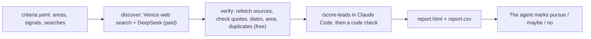

# real-estate-gtm-engine

Lead tools for a real estate agent, in two parts:
- **The pilot (`gtm pilot`):** finds publicly documented selling opportunities in the Los Angeles
  area with live web search. It checks every source and scores what survives, then produces a
  short report for the agent to judge. [pilot/README.md](pilot/README.md)
- **The contact pipeline (`gtm run`):** researches each imported contact with cited evidence and
  qualifies them on two criteria only, service area and an expressed property need. For qualified
  contacts it writes a first email for a person to review.

Neither part ever contacts anyone.

> **Status: early development.** Everything under "What works today" is verified locally with
> **fake** providers and synthetic data. The pilot's live Venice discovery hasn't run yet.
> Deepline and Parallel aren't connected to this code. See [docs/STATUS.md](docs/STATUS.md).

## The pilot



```bash
uv run gtm pilot discover                          # plan and worst-case cost; sends nothing
uv run gtm pilot discover --label first-five --only fsbo_south_bay --execute
uv run gtm pilot discover --resume <run> --execute  # the rest; saved searches aren't repaid
uv run gtm pilot verify --run-dir <run>
#   in Claude Code: /score-leads <run>
uv run gtm pilot report --run-dir <run>
uv run gtm pilot status --run-dir <run>            # where a run stands and the next command
```
Run data goes to `~/gtm-data/pilot/<date>/<run id>/`, outside git. Every request, response,
source snapshot, and cost is kept there. Full runbook, costs, and the questions to ask the agent:
[pilot/README.md](pilot/README.md).

## How the contact pipeline works


- **One program, one lead and one stage at a time.** Research, checking, and writing are steps in
  one Python program. Each step starts a fresh model conversation built from saved records.
- **Code decides.** Code checks every citation (right person, recent, says what's claimed), makes
  the qualification decision, and chooses the next step.
- **The database is the master list.** One record per person, a do-not-contact list, the reason
  behind every rejection, and every step's saved result. A stopped run picks up where it left off
  without repeating paid calls.

## Tools
| Tool | Role |
|---|---|
| Pi | Coding agent on the shared VM, for development and trying tools by hand (`gpi` starts it on the pilot model) |
| Venice | Hosts the model (DeepSeek V4.1 Flash Uncensored) and runs the pilot's web searches |
| Claude Code | Runs the `/score-leads` skill on verified opportunities |
| Deepline | Contact enrichment, by hand and only with approval (installed on the VM; not used by the pilot's code) |
| Parallel | Not used: the pilot searches through Venice |
| Supabase | Hosted PostgreSQL for the contact pipeline (planned; the pilot uses files) |

Pi is for exploring; `gtm pilot` and `gtm run` are the repeatable commands. What's verified and
what isn't: [docs/tools.md](docs/tools.md).

## What works today

Verified 2026-10-30 with fake providers and synthetic data on PostgreSQL 17 (`uv run pytest`: 60 passed).

| Feature | Status |
|---|---|
| Pilot discovery: request building, dry-run plan, cost log, budget stop, no-sources stop, resume without repaying | Works (fake Venice); live run not done yet |
| Pilot verification: quotes, dates, area, agent status, contradictions, duplicates within and across runs | Works (fake web pages) |
| Pilot scoring check and HTML/CSV report with phones and emails removed | Works |
| Brokerage configuration in one YAML file, saved with each run | Works |
| CSV import with dedupe, do-not-contact list, and versioned records | Works |
| Research with a bounded, read-only search loop | Works (fake model and search) |
| Citation checks and code-made qualification | Works (fake claim checker) |
| Writer context built from the saved checked result | Works |
| Email rule checks plus a model sentence check, before any draft | Works (fake checker) |
| Resume after a stop, with no repeated calls | Works |
| Per-job call limits and a spending cap per run | Works |
| Venice, Deepline, and Parallel connections for `gtm run`; Gmail drafts | Not built yet ([roadmap](#roadmap)) |

## Quick start

Requires Python 3.13, [uv](https://docs.astral.sh/uv/), and PostgreSQL 17 binaries
(`brew install postgresql@17`). The tests and demo start their own throwaway database.

```bash
uv sync
uv run gtm demo --fake-providers   # fictional end-to-end run, a few seconds
uv run pytest
```

The demo imports five fictional contacts for the fictional brokerage "Example Homes". It stops
the program after the first finished job, restarts it, and prints the outcomes:

```text
=== 2. Stop after the first finished job, then restart ===
first program finished 1 research job; the restarted program processed 8 more
provider calls for the finished job: 3 before restart, 3 after

=== 3. Outcomes ===
  Avery Park     disqualified           property_location_outside_service_area
  Jordan Lee     ready_for_draft
  Morgan Diaz    insufficient_evidence  evidence_stale
  Riley Chen     insufficient_evidence  property_location_missing

=== 4. Run again with nothing changed ===
0 jobs created, 4 reused, 0 processed, 0 new provider calls
```

The finished job's calls weren't repeated after the restart. The fifth contact was on the
do-not-contact list, so their details were never stored. Jordan
lives in Seattle and asked for help buying in Torrance, so Jordan qualifies: service fit uses
where the person wants to buy, not where they live. A fictional web page about a *different*
Jordan Lee, which also contains a prompt injection, is excluded by the identity check. The full
trace, including the exact writer input, is in [docs/context-handoffs.md](docs/context-handoffs.md).

### Commands
The database URL comes from `GTM_DATABASE_URL`.

```bash
gtm import contacts.csv --source-label "website inquiries"
gtm suppress --email person@mail.example
gtm run --config config/examples/example-homes.yaml --fake-providers
gtm trace --lead <lead-id>
```

## Documentation
- [pilot/README.md](pilot/README.md): the opportunity-report pilot: runbook, costs, and what counts as an opportunity
- [docs/tools.md](docs/tools.md): what each outside tool does, and what's actually set up
- [docs/architecture.md](docs/architecture.md): the program, database, and safeguards
- [docs/context-handoffs.md](docs/context-handoffs.md): what each step receives, with a fictional trace
- [docs/contracts/](docs/contracts/): JSON Schemas for every stored record and model input/output
- [docs/sketch-notes.md](docs/sketch-notes.md): how the original workflow sketch maps to the design
- [docs/STATUS.md](docs/STATUS.md): verified progress, decisions, and the next task
- [AGENTS.md](AGENTS.md): development rules

## Repository layout
```
src/gtm/            cli, config, contracts, db, queue, context, calls, worker, runs, validation, trace, demo
src/gtm/pilot/      the pilot: models, discover, verify, report, cli
src/gtm/pipeline/   importing, research, checks, write
src/gtm/providers/  provider interfaces and deterministic fakes
supabase/migrations the database schema
prompts/            versioned role instructions (researcher, claim_check, writer, email_check)
pilot/              criteria, the versioned discovery prompt, and JSON Schemas for each pilot file
.claude/skills/     score-leads (the pilot's scoring skill)
config/examples/    a fictional brokerage and fictional contacts
tests/              pilot, pipeline, resume, identities, limits, email checks, repo rules
```

## Roadmap
1. **Pilot, live:** one search to prove Venice web search returns real sources, then five
   verified opportunities reviewed by the agent; 10–15 if he finds them useful.
2. Tune the criteria from his verdicts: which signals, areas, and searches find what he'd pursue.
3. Deepline enrichment for opportunities he chooses, with an agreed spending cap.
4. Venice and Deepline connections for `gtm run`; pilot results feed the master list, deduplicated.
5. Gmail drafts, created for review only.

## Public repository rules
This repository is public. It contains only fictional people, brokerages, and web pages, all on
`.example` domains. Real brokerage configuration, contacts, and credentials are never committed.
CI runs a public-safety scan and gitleaks.
