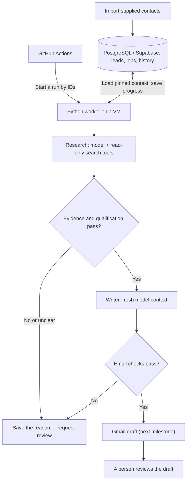

# real-estate-gtm-engine

A real estate outreach pipeline for brokerages. It researches supplied contacts with cited
evidence, qualifies them on two criteria only (service area and expressed property need), and
writes a personalized first email for a person to review as a Gmail draft. It never sends email.

Each brokerage is set up through configuration: its own sender facts, mailbox, service area,
offer, and tone. All of one brokerage's data stays isolated from every other brokerage.

> **Status: early development.** Everything below "What works today" is verified locally with
> **fake** model, research, and email providers. No real model, Deepline, Gmail, or Supabase
> connection exists yet. See [docs/STATUS.md](docs/STATUS.md).

## How it works



- **One lead, one stage, one fresh context.** Research, checking, and writing run as separate
  jobs. Each job pins its exact inputs, and the worker builds the model request from saved records.
  No conversation history carries over.
- **Ordinary code decides.** Code checks identity, recency, and meaning for every citation,
  makes the qualification decision, and chooses the next stage.
- **Every step is saved atomically.** A finished stage commits its result and the next job in one
  transaction. A restarted worker continues from the last saved stage without repeating paid calls.
- **Isolation is enforced by the database.** Every tenant table has forced row level security,
  and runtime roles cannot bypass it.

## What works today

Verified 2026-10-27 with fake providers on PostgreSQL 17 (`uv run pytest`: 52 passed).

| Feature | Status |
|---|---|
| Brokerage configuration (YAML → immutable, pinned config versions) | Works |
| Contact CSV import with dedupe, suppression, and versioned records | Works |
| Research stage with a bounded, read-only tool loop | Works (fake model and tools) |
| Citation checks and code-made qualification | Works (fake claim checker) |
| Writer context built from the saved checked result | Works |
| Email code checks plus model sentence check, before any draft | Works (fake checker) |
| Job queue: atomic claim, lease, fencing token, restart reuse | Works |
| Per-job call limits and per-run budget, including uncertain spend | Works |
| Two-brokerage isolation tested as the runtime roles | Works |
| Gmail drafts, review command, real providers, VM deploy | Not built yet ([roadmap](#roadmap)) |

## Quick start

Requires Python 3.13, [uv](https://docs.astral.sh/uv/), and PostgreSQL 17 binaries
(`brew install postgresql@17`). The tests and demo start their own throwaway database cluster,
so they never use a running PostgreSQL server.

```bash
uv sync
uv run gtm demo --fake-providers   # fictional end-to-end run, about 2 seconds
uv run pytest
```

The demo imports five fictional contacts for the fictional brokerage "Example Homes". It runs the
worker, stops it after the first research commit, starts a new worker, and prints each outcome
and the full handoff chain for one lead:

```text
  Jordan Lee     ready_for_draft
  Avery Park     disqualified           property_location_outside_service_area
  Morgan Diaz    insufficient_evidence  evidence_stale
  Riley Chen     insufficient_evidence  property_location_missing
  Sam Okafor     suppressed at import   (no record stored)

provider calls for worker A's completed job after restart: 0 new
run …: 0 jobs created, 4 reused; worker processed 0 jobs; new provider calls: 0
```

Jordan lives in Seattle and asked for help buying in Torrance, so Jordan qualifies: service fit
uses where the person wants to buy, not where they live. A fictional web page about a different
Jordan Lee (in Portland) is excluded by the identity check. That page also contains a prompt
injection, which the researcher receives only as marked, untrusted data. The writer then gets
only checked findings and sender facts:

```text
     subject: Your home search
     | Hi Jordan,
     |
     | Thank you for your recent inquiry about your home search. Taylor Morgan helps buyers
     | find homes across Torrance and the South Bay.
     |
     | Would a brief call this week be useful?
     code checks: passed
     email check: completed
```

The fake writer's text is deliberately plain; it exercises the pipeline, not writing quality.
The full trace, including the exact writer input, is in
[docs/context-handoffs.md](docs/context-handoffs.md).

### Operator commands
Each command connects as the least-privileged database role it needs, from
`GTM_APP_DATABASE_URL`, `GTM_TRIGGER_DATABASE_URL`, or `GTM_WORKER_DATABASE_URL`.

```bash
gtm config apply config/examples/example-homes.yaml
gtm import contacts.csv --tenant-id <uuid> --campaign south-bay-buyers --source-label "website inquiries"
gtm enqueue --tenant-id <uuid> --campaign-id <uuid> --import-id <uuid> --trigger-id <id>
gtm worker --fake-providers
gtm status --tenant-id <uuid> --run-id <uuid>
gtm trace --tenant-id <uuid> --lead-id <uuid>
gtm suppress --tenant-id <uuid> --email person@mail.example
gtm campaign pause|resume --tenant-id <uuid> --campaign <slug>
```

## Documentation
- [docs/architecture.md](docs/architecture.md): components, roles, isolation, queue, and limits
- [docs/context-handoffs.md](docs/context-handoffs.md): how each stage's context is built, with a fictional trace
- [docs/contracts/](docs/contracts/): JSON Schemas for every stored record and model input/output
- [docs/operations.md](docs/operations.md): database roles and environment setup
- [docs/sketch-notes.md](docs/sketch-notes.md): how the original workflow sketch maps to the design
- [docs/STATUS.md](docs/STATUS.md): verified progress, decisions, blockers, and the next task
- [AGENTS.md](AGENTS.md): development rules for people and coding agents

## Repository layout
```
src/gtm/            cli, config, contracts, db, queue, context, calls, worker, validation, trace, demo
src/gtm/pipeline/   importing, research, checks, write
src/gtm/providers/  provider interfaces and deterministic fakes
supabase/migrations one SQL migration history (schema, roles, RLS, functions)
prompts/            versioned role instructions (researcher, claim_check, writer, email_check)
config/examples/    two fictional brokerages and fictional contact lists
tests/              isolation, pipeline, restart, identities, limits, live checks, email checks
scripts/            public-safety scan
```

## Roadmap
1. Gmail draft operation with a fake Gmail client: one draft per outreach item, live rechecks, and
   reconciliation of uncertain outcomes. Then `gtm review`.
2. Hosted model and Deepline adapters, `gtm providers check`, and a model evaluation on fictional cases.
3. Gmail OAuth onboarding and the draft-only client.
4. Supabase project, VM worker service, `deploy.yml` and `run.yml`, backups and a restore check.
5. Pilot: five supplied contacts, every outcome reviewed by a person.
6. Later: discovery experiment, approved sending, follow-ups, and more brokerages.

## Public repository rules
This repository is public. It contains only fictional people, brokerages, and web pages, all on
`.example` domains. Real brokerage configuration, contacts, and credentials are never committed.
CI runs a public-safety scan and gitleaks.
