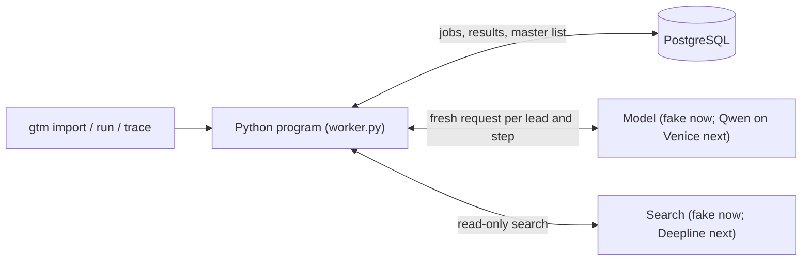

# Architecture

One Python program and one PostgreSQL database per customer.

## The loop
1. `gtm run` saves the resolved config (including prompt text) on a new **run** and queues a
   research job for each lead's latest record. Research is keyed by `research/{record}/r{rerun}`,
   so already-researched leads are reused.
2. The worker takes the oldest queued job (`queue.next_job`). On startup it re-queues any job a
   stopped program left running.
3. `build_context` (`context.py`) loads exactly the records the job points to, plus its run's
   config. Each stage selects only what its role may see.
4. The stage runs (`pipeline/research.py`, `checks.py`, `write.py`). Every model or search call
   is checked against the run's spending cap and saved to `provider_calls` before it's sent
   (`calls.py`).
5. `complete_stage` saves the result, marks the job done, inserts the next job, and updates the
   lead, all in **one transaction**.

| Step | Consumes | Produces | Next |
|---|---|---|---|
| research | lead record (no email) | findings, citations, retrieved sources | check |
| check | that research result | checked findings, citation checks, decision | write, only if qualified |
| write | that checked result + sender facts | email, rule-check results, sentence verdicts | draft, only if both pass |
| draft | that writing result | Gmail draft (not built yet) | none |

## Safeguards
- **No repeated paid work:** results are saved atomically, and jobs are keyed by their input.
- **Limits:** per-job caps on model calls, tokens, and JSON repairs; at most 3 searches and 3
  page reads per lead; a spending cap per run. Timed-out or interrupted calls count as spent.
- **Untrusted pages:** page text reaches the researcher only as marked data. Code verifies every
  quote and URL. The writer never sees page text or the email address.
- **Code decides:** qualification, the next step, and what an email may say (`validation.py`).
  Models propose; they never choose the next step.
- **One first email per lead** (`outreach_items`), and a do-not-contact list checked at import
  and before every paid step.
- **Immutable history:** lead records and step results can't be updated.

Running two programs against one database at the same time is not supported. The startup
recovery assumes one program.
