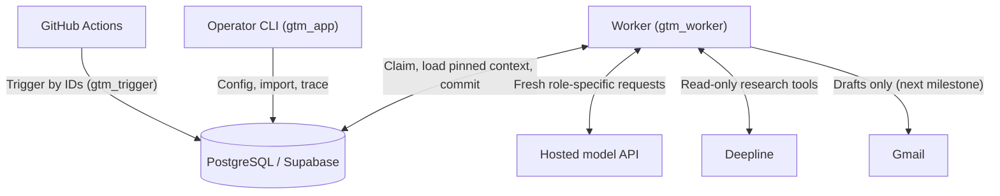

# Architecture

This document covers what exists in code today. The full design is the implementation plan
(revision 3).

## Components
| Component | Responsibility | Status |
|---|---|---|
| PostgreSQL (Supabase when hosted) | Configuration, contacts, jobs, results, evidence, context snapshots, costs, outreach identity | Schema built; tested on local PostgreSQL 17 |
| Python worker (`gtm/worker.py`) | Claims one job at a time, builds fresh context, calls providers, validates, commits | Built (fake providers) |
| Operator CLI (`gtm/cli.py`) | Configuration, import, suppression, campaign status, trace | Built |
| Trigger (`gtm enqueue`, `gtm status`) | Starts a run by IDs; reads counts only | Built; Actions wiring not yet |
| Providers (`gtm/providers/`) | Model and read-only research tools behind interfaces | Fakes only |

## Database roles
| Role | Login | What it can do |
|---|---|---|
| `gtm_worker` | yes | Claim jobs (`gtm.claim_job`), read pinned inputs, write results, update job and lead state, record provider calls. Tenant-scoped. |
| `gtm_app` | yes | Apply configuration, import contacts, suppress, pause or resume campaigns, read for trace, call enqueue and status. Tenant-scoped. |
| `gtm_trigger` | yes | Execute `gtm.enqueue_run` and `gtm.run_status` only. No table access. |
| `gtm_claim_owner` | no | Owns `claim_job`. Reads and updates only queue columns of `jobs`, across tenants. |
| `gtm_enqueue_owner` | no | Owns `enqueue_run` and `run_status`. Tenant-scoped reads and inserts for runs and jobs. |

None of these roles is a superuser or has `BYPASSRLS`. Migrations run as the project's migration
role (Supabase: `postgres`). The tests apply them as a non-superuser role with the same
CREATEROLE, CREATEDB, and BYPASSRLS attributes.

## Company isolation
- Every tenant table carries `tenant_id`, `UNIQUE (tenant_id, id)`, and composite foreign keys, so
  a record can only reference parents in its own tenant.
- Row level security is enabled and **forced** on every tenant table. The policy compares
  `tenant_id` with `gtm.current_tenant()`, which reads the transaction-local `app.tenant_id`.
  A missing or empty setting returns no rows.
- Trusted code sets the scope with `tenant_tx()` from the claimed job's tenant, never from model
  output. The scope never outlives one transaction.
- Privileged functions are `SECURITY DEFINER` with `search_path = pg_catalog, pg_temp`. They
  have no `PUBLIC` execute, and their owners are the no-login roles above. `enqueue_run` validates
  campaign and import ownership inside the tenant scope and restores the caller's scope on return.
- **The trusted-worker limit.** The shared worker can choose any tenant when it claims a job,
  and later it will hold the application encryption key. It is a trusted platform component. RLS
  catches common accidental cross-tenant access. It does not protect against every authorization
  bug, and it cannot protect against a compromised worker.

## Queue, leases, and completion
- `gtm.claim_job` selects one eligible job with `FOR UPDATE SKIP LOCKED`, sets a lease, and
  increments the fencing token. An eligible job is either queued, or running with an expired lease.
- `build_context` verifies ownership, loads the exact pinned inputs, and stores the
  application-built model messages as a private `context_snapshots` row. Retries reuse it.
- `execute` runs the provider calls outside any transaction. Each call is recorded and reserved
  against the run budget before dispatch.
- `complete_stage` is one transaction. It verifies the token and lease, inserts the immutable
  result (plus citations, checks, and decision), and inserts the next job under its input-based
  key. It also marks the job complete and updates the lead state. A replay with the same output
  returns the saved result; a different output is rejected.
- Job keys: `research/{lead_record_id}/{fp}`, `check/{research_result_id}/{fp}`,
  `write/{checked_result_id}/{fp}`, and `draft/{outreach_item_id}`. `fp` hashes the
  stage-relevant configuration (prompt hash, model, limits, policy version) and the rerun number.
- Outreach identity: `outreach_items` is unique per (tenant, campaign, lead, step). A later writing
  version can never schedule a second first-touch draft.

## Limits and budget
- Per-job limits come from the pinned configuration: model calls (repairs included), input and
  output tokens per call, and JSON repairs. Research tools are also limited to 3 searches of 5
  results and 3 page reads of at most 4,000 characters.
- Run budget: a call proceeds only while `settled + reserved + uncertain + estimate ≤ cap`.
  A timeout moves its reservation to `uncertain`, which counts as spent. Calls interrupted by a
  crash become `uncertain` when the job is retried. A blocked call pauses the run.

## Stage rules (code)
| Stage | Input | Output | Next |
|---|---|---|---|
| research | lead record (no email), campaign area and categories | `research.output.v1` + private retrieved sources + citation rows | check |
| check | that exact research result | `checked_research.v1`, citation checks, qualification decision | write, only if qualified |
| write | that exact checked result, sender facts for outreach, tone | writing result with code checks and email-check verdicts | draft, only if both pass |
| draft | that exact writing result | Gmail operation (not built yet) | none |
